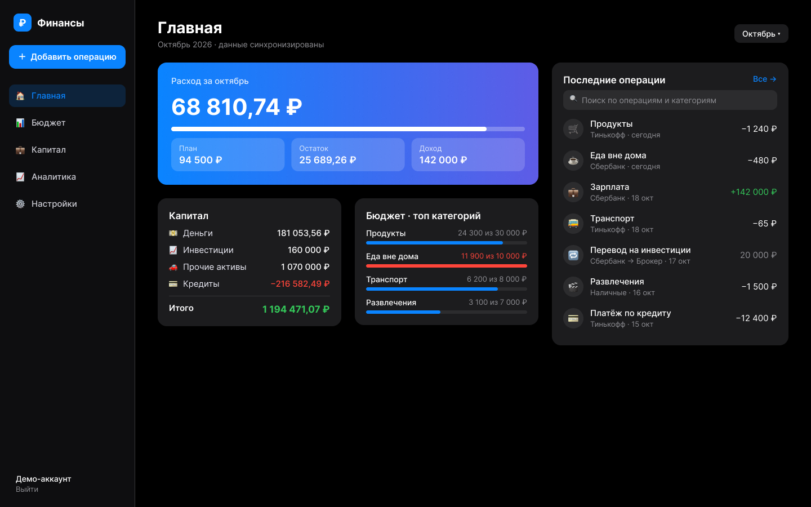

# Как делался проект: AI-агенты на каждом этапе

Итоговый проект курса по AI-агентам. Приложение «Финансы» прошло путь от идеи до прода за
шесть домашних заданий и итоговую доработку. Почти весь код, документацию и инфраструктуру
написал AI-агент. Человек выбирал направление, принимал решения, проверял результат и
останавливал агента, когда тот уходил не туда.

| | |
|---|---|
| **Агент** | Claude Code (Opus 5 → Opus 5.5), терминал. Выбран в ДЗ 1 из шести инструментов: локальная работа без передачи секретов, доступ ко всему репозиторию, сам гоняет тесты |
| **Приёмы** | субагенты (параллельная работа, независимые аудиторы), MCP (Figma, браузер), `claude -p` в скриптах, правила проекта (`CLAUDE.md`) |
| **Доказательства** | 23+ коммитов с `Co-Authored-By: Claude`; дословные промпты из журналов сессий — [docs/process/02-prompts-from-sessions.md](docs/process/02-prompts-from-sessions.md) |
| **Честность** | Где промпта не было, так и написано. Где AI ошибся — описано в разделе 6 |

Как читать: разделы 1–4 — этапы из требований (планирование, разработка, бэкенд и
инфраструктура, отладка). В каждом — что делал AI, пример промпта, результат и где лежит
артефакт. Раздел 5 — проблемы и решения, раздел 6 — где AI ошибался, раздел 7 — выводы.

---

## Карта этапов

| Этап | Что сделал AI | Артефакт | Промпт |
|---|---|---|---|
| Идея | Проверил идею: 5 альтернатив, оценка, Lean Canvas | [01-idea-and-competitors.md](docs/process/01-idea-and-competitors.md) §1–2 | дословно |
| Конкуренты | 9 решений, 12 критериев, 21 источник, веб-поиск | там же, §3–4 | дословно, 36 вызовов |
| UI-концепции | 3 концепции × 2 темы (ДЗ 3), десктоп в Figma (итог) | `ДЗ 3/ui_concepts/`, [03-desktop-concept.md](docs/process/03-desktop-concept.md) | бриф дословно |
| User Stories и ТЗ | 15 историй, 54 критерия приёмки, 38 FR, 24 NFR | `ДЗ 3/user_stories.md`, `technical_specification.md` | текст задания |
| Инициализация | Vite + React + TS, конфиги, правила агента | `vite.config.ts`, `CLAUDE.md` | текст задания |
| Компоненты | Экраны, API-клиент, мок-сервер для тестов | `src/` | дословно |
| Рефакторинг | Общие состояния ошибок, чистка мёртвого кода | коммиты 20.10 | дословно |
| Тесты | Юнит, экраны, интеграционные против Supabase | `src/**/*.test.ts*`, `src/test/api/` | в промптах субагентам |
| БД | 11 таблиц, перенос модели прода в PostgreSQL | `supabase/migrations/` | текст задания |
| Миграции, RLS | 12 политик, SQL-функции проводок | там же | текст задания |
| API | 58 маршрутов, 6 параллельных субагентов | `supabase/functions/api/` | дословно |
| Docker, CI/CD | Образ, compose, 3 пайплайна, шлюз выкладки | `Dockerfile`, `.github/workflows/` | текст задания |
| Анализ ошибок | Скрипт разбора логов через Claude, отладка по скриншотам | `scripts/analyze-logs.mjs` | дословно |
| Оптимизация | −31 % стартовой загрузки, запрос капитала в 2,5 раза быстрее | `integration_documentation.md` §6 | — |
| Аудит безопасности | 2 независимых аудитора, 29 находок | `security_audit.md` | дословно |

---

## 1. Планирование и дизайн

### 1.1 Идея и её проверка

**Откуда идея.** Не сгенерирована с нуля: автор вёл учёт в таблице, бросил из-за рутины и
сделал себе Telegram-бота. Задача курса — довести его до полноценного продукта.

**Что сделал AI.** Субагент с веб-поиском проверил идею: сгенерировал 5 альтернатив в том же
домене, оценил все 6 по боли, конкуренции, реализуемости и демонстрации навыков, собрал Lean
Canvas. Текущая идея делит первое место (15 баллов) с «планировщиком кредитов». Вывод AI:
рынок плотный (конкуренция 1 из 5), продукту нужна узкая ниша.

### 1.2 Анализ конкурентов

Субагент разобрал CoinKeeper, Дзен-мани, Monefy, Money Manager, Spendee, YNAB, Wallet,
FinNotes и банковскую аналитику: 16 поисковых запросов, 20 страниц, 21 источник с датой.
Каждый факт со ссылкой, непроверенное помечено.

> «Разбери 6–8 актуальных конкурентов для русскоязычного пользователя … Каждый факт — со ссылкой
> на источник; если цену/факт не удалось подтвердить — пометь «не подтверждено» и напиши, где
> искал. … Никаких выдуманных цифр.»

**Результат.** Три дифференциатора: Telegram + капитал в одном продукте; кредиты с разбивкой
платежа на тело и проценты; нулевой порог входа. Три пробела: нет импорта из банков, нет
совместного бюджета, нет мультивалютности.

**Проверка человеком.** Курс ЦБ сверен по XML ЦБ — совпал. На странице Дзен-мани в App Store
найден AI-ассистент, которого агент не заметил; добавлен в пробелы. Урок: AI-исследование
нужно выборочно сверять с первоисточником.

### 1.3 UI-концепции через Text-to-UI

**ДЗ 3.** Агент сгенерировал три концепции (минимализм, яркая, корпоративная) в двух темах как
HTML, Playwright снял скриншоты, концепции оценены по таблице (37 / 40 / 30). Внешние сервисы
(v0, Galileo) не использовались: нужна регистрация или платный тариф — пользователь выбрал
«HTML-макеты + скриншоты».

**Выбрана концепция B, затем отвергнута.** Агент провёл редизайн живого приложения по ней —
8 этапов за 2,5 часа. Пользователь посмотрел на реальных данных и свернул:

> «вообще не нравится по сравнению с тем дизайном, который есть сейчас
> давай свернем эту затею»

В прод попал только донат «Куда ушли деньги». Урок: концепцию надо проверять на реальных
данных до полной реализации.

**Итоговый проект — десктоп в Figma.** Аудит показал, что десктопной вёрстки нет. Агент по
текстовому брифу построил макет прямо в Figma через MCP — редактируемые слои и компоненты:

> «Десктопная версия Главной, 1440 × 900, тёмная тема в палитре приложения … Слева сайдбар
> 240 px: логотип, главная кнопка «＋ Добавить операцию», навигация … Справа колонка 420 px
> «Последние операции»: поле поиска по операциям и категориям, 7 строк операции …»



Подробно, включая проблему со шрифтом, — [03-desktop-concept.md](docs/process/03-desktop-concept.md).

### 1.4 User Stories и техническое задание

Агент написал по тексту задания ДЗ 3: 3 персоны, 15 историй в формате «Как … я хочу … чтобы»,
54 критерия приёмки Given-When-Then (27 негативных), ТЗ с 38 функциональными и 24
нефункциональными требованиями, моделью данных и API. Отдельного промпта не было — агент
работал от текста задания и уточняющих вопросов.

---

## 2. Разработка

### 2.1 Инициализация и правила агента

Агент создал проект (`npm create vite@latest … --template react-ts`), настроил Tailwind,
Vitest, алиасы. Правила работы агента прошли эволюцию:

```
ДЗ 2: система правил Role → Context → Style → Constraints → Format (.cursorrules, другой проект)
  → ДЗ 4: .cursorrules «Финансов» — фронтенд с демо-сервером
  → итог: CLAUDE.md — фулстек на Supabase, запреты из найденных ошибок (X7, X8)
```

Запреты X7 и X8 в `CLAUDE.md` появились из инцидента 20.10 (раздел 5): правила пополняются
уроками, а не пишутся один раз.

### 2.2 Генерация компонентов

Пользователь поправил курс посреди работы агента — тот начал писать экраны «по мотивам» прода:

> «оставь дизайн как он есть сейчас на проде у мня, не надо его переделывать именно под ДЗ»

Агент перенёс код прода и написал браузерный мок-сервер. Спецификацию API для него получил
от субагента (дословно):

> «Мне нужна КОМПАКТНАЯ спецификация поведения каждого эндпоинта /api/* … Читай код, не
> выдумывай. Для каждого эндпоинта дай: метод+путь, query/body, что возвращает …, коды ошибок
> с текстом {error}. … Особенно важно точно (с цитатой строки кода, если есть неоднозначность)»

**Результат.** Мок-сервер повторяет формы ответов прода; на нём работают тесты экранов.

### 2.3 Рефакторинг

Итоговый проект: субагент вынес обработку ошибок загрузки в общий компонент для всех экранов
и удалил мёртвый код (вызовы несуществующих эндпоинтов, неработающий переключатель).
Промпт задаёт границы — что трогать нельзя, как проверять, как отчитаться:

> «ОГРАНИЧЕНИЯ: НЕ трогай вёрстку/адаптивность … — этим параллельно занимается другой
> исполнитель … ОТЧЁТ в конце: список коммитов, что сделано по каждой задаче с file:line,
> результаты всех проверок (цифры тестов), что не получилось и почему. Не приукрашивай»

### 2.4 Тесты

| Набор | Сколько | Что проверяет |
|---|---|---|
| Юнит и экраны (Vitest + Testing Library) | 79 | экраны, расчёты, события аналитики, nonce входа Google |
| Интеграционные против Supabase в контейнере | 78 | изоляция данных (RLS), CRUD, остатки, кредиты, регрессии аудита, инцидент 20.10 |

Правило из `CLAUDE.md`: тест на баг сначала должен упасть на старом коде. Так проверены
регрессии аудита, событий аналитики и инцидента.

---

## 3. Backend и инфраструктура

### 3.1 База данных и миграции

Агент перенёс модель данных прода (Prisma) в PostgreSQL для Supabase: 11 таблиц, деньги в
`numeric(14,2)`, остатки счетов журналом, идемпотентность по `client_tx_id`, RLS на всех
таблицах, SQL-функции проводок. Затем аудит добавил миграцию усиления: ограничения длины,
блокировки в порядке id, ограничительные политики.

### 3.2 API: шесть параллельных субагентов

Сначала субагент составил инвентаризацию контракта — ТЗ для бэкенда. Затем основной агент
написал общий фундамент (`lib/`, эталон стиля) и запустил 6 субагентов, по домену на каждого.
Фрагмент промпта (полностью — в журнале промптов):

> «Ты пишешь один домен бэкенда «Финансы» (Supabase Edge Function на Deno). Работай ТОЛЬКО в
> файле: …/routes/catalogs.ts. Другие файлы не меняй (их параллельно пишут другие агенты). …
> ЭТАЛОН ПОВЕДЕНИЯ (источник истины, цифры и тексты ошибок копируй дословно) … ЭТАЛОН СТИЛЯ
> КОДА: routes/profile.ts — прочитай его первым. … Проверь синтаксис и типы: `deno check`»

**Результат.** 58 маршрутов за ~15 минут. Субагенты нашли ошибку в общем фундаменте
(`clampedInt` возвращал 1 вместо значения по умолчанию) — исправлена в одном месте.

### 3.3 Docker и CI/CD

**CI/CD.** Агент написал три пайплайна: `ci.yml` (линтер, типы, тесты, тесты API на Supabase в
контейнере, образ Docker, деплой бэкенда), `security.yml` (npm audit, gitleaks, CodeQL),
`monitor.yml` (проверка прода по расписанию, алерт issue). Фронтенд выкладывает Vercel только
после зелёного CI: перед сборкой `scripts/vercel-wait-ci.mjs` ждёт статус запуска в GitHub.

**Docker.** Многоэтапный образ: сборка на Node 22, раздача непривилегированным nginx с
маршрутами SPA и заголовками безопасности. `docker-compose.yml` поднимает фронтенд рядом с
локальным Supabase. CI собирает образ и проверяет: контейнер отвечает, заголовки на месте,
процесс не root.

---

## 4. Отладка и оптимизация

### 4.1 Анализ ошибок с AI

**Разбор логов.** `scripts/analyze-logs.mjs`: сводку (уровни, пути, p95) считает код, выводы
делает Claude через `claude -p` без инструментов. Промпт (фрагмент):

> «Ты дежурный инженер (SRE) сервиса личных финансов … Задача — найти проблемы, которые требуют
> действий, и отделить их от шума. … Не включай ожидаемое поведение (например, 401 при
> просроченном токене …). … Не выдумывай: если данных не хватает для вывода, так и напиши.»

Результат на подготовленной выборке реального лога — `docs/log-analysis-example.md`: модель
нашла настоящий deadlock с местом в коде и распознала проверочную попытку внедрить инструкцию
через лог как атаку, не выполнив её.

**Отладка по скриншотам.** В ДЗ 4 агент снимал экраны на 4 ширинах и находил дефекты
(горизонтальная прокрутка на 4 px, выход на экран входа при сбое сети) — 5 исправлены в проде.

### 4.2 Оптимизация производительности

| Что | До | После | Как |
|---|---|---|---|
| Стартовая загрузка | 187 КБ gzip | 130 КБ gzip (−31 %) | ленивые экраны, отдельные чанки, клиент Auth вместо полного supabase-js |
| `GET /capital`, 30 000 строк истории | 15,1 мс | 5,5–6,4 мс | SQL-функция берёт верхнюю строку индекса на счёт |

Первая версия оптимизации запроса (`DISTINCT ON`) оказалась **медленнее** — 21 мс. Агент
заметил это по замеру и переписал. Без замера «оптимизация» ухудшила бы прод.

### 4.3 Аудит безопасности

Два субагента-аудитора работали параллельно и независимо: бэкенд и фронтенд с конфигурацией.
Им запрещено править код — только анализ с подтверждением. Фрагмент промпта:

> «Проведи аудит безопасности бэкенда … по OWASP Top 10 (2021). Ничего не правь — только анализ
> и отчёт. … Где возможно — ПОДТВЕРДИ находку чтением кода до конца … проверь находки реальными
> запросами curl. … Не раздувай: ложные срабатывания хуже пропуска»

**Результат.** 29 находок, критических нет, все High и Medium исправлены с регрессионными
тестами. Главные: общий демо-аккаунт можно было испортить для всех; параллельные операции
теряли обновления остатков. Аудитор фронтенда нашёл проблемы в только что сгенерированном CI —
AI проверял AI. Полный отчёт — [security_audit.md](security_audit.md).

---

## 5. Проблемы и решения

| # | Проблема | Причина | Решение | Как нашли |
|---|---|---|---|---|
| 1 | 8 параллельных доходов по 100 ₽ дают +300 вместо +800 | остаток читался и писался без блокировки; затем deadlock из-за порядка блокировок | `FOR NO KEY UPDATE` заранее, в порядке id; текущий остаток по `seq` | аудитор → тест → request_id в логе |
| 2 | Ночная уборка стёрла всё демо (160 операций) | «момент наполнения» = создание профиля, раньше данных; затем часы Mac отставали от базы на ~60 мс | отметку ставит сама база (`clock_timestamp()`); без отметки уборка ничего не удаляет; мониторинг проверяет содержимое | вручную; тест подтвердил разницу часов |
| 3 | Посетитель мог сменить пароль общего демо | `secure_password_change = false` | триггер защиты демо + настройка Auth | аудитор |
| 4 | События операций не доходили до GA4 | `onSuccess` экрана заменяет общий `onSuccess` TanStack Query | событие отправляется из `mutationFn`; тест | проверка на проде |
| 5 | Vercel выкладывал прод в обход CI | git-интеграция деплоила каждый пуш | шлюз `vercel-wait-ci.mjs` | аудитор |
| 6 | Текст из логов попадал в промпт модели | анонимный приём ошибок браузера → разбор через модель | модель без инструментов, маркеры «недоверенные данные» | аудитор |
| 7 | Вход через Google требовал секрет, которого у агента нет | обмен кода на токены требует Client Secret | вход по ID-токену: проверка подписи Google, секрет не нужен | ограничение безопасности |
| 8 | Кнопка Google вела на JSON-ошибку | провайдер выключен | экран читает публичные настройки Auth, кнопка неактивна с подсказкой | проверка на проде |
| 9 | Все запросы к API — «нет обработчика» | шлюз передаёт путь `/api/…`, а не `/functions/v1/api/…` | разбор пути | логи |
| 10 | В макете Figma не было ни одного текста | у SF Pro нет метрик на сервере Figma | Inter, пересчёт раскладки | скриншот макета |
| 11 | У статики в Docker пропадали заголовки безопасности | `add_header` в `location` отменяет заголовки `server` | общий файл заголовков в каждом `location` | ревью конфига до запуска |
| 12 | Монитор «каждые 15 минут» запускался раз в 1–5 часов | GitHub задерживает cron в малоактивных репо | честная формулировка; для SLA — внешний пинг | журнал запусков |
| 13 | Бюджет при сбое сети — вечный скелетон | ошибка запроса не обрабатывалась | общий компонент ошибки с повтором на всех экранах | аудит требований |

---

## 6. Где AI ошибался и что поправил человек

| Ситуация | Что случилось | Урок |
|---|---|---|
| Редизайн по концепции B | 8 этапов сделаны, на реальных данных хуже исходного — откат | проверять концепцию на реальных данных до полной реализации |
| Экраны «по мотивам» прода в ДЗ 4 | агент начал переделывать дизайн, пользователь остановил | явно фиксировать, что менять нельзя (правило X1 в ДЗ 4) |
| Инцидент 20.10 | первое исправление тоже стирало данные; гипотезу о разнице часов агент сначала отбросил, сравнив время до секунды | сравнивать время из одного источника; гипотезу проверять тестом, а не рассуждением |
| Окно с секретом Google | агент закрыл окно с Client Secret, перейдя по другой ссылке в той же вкладке | секреты — только человеку; позже нашёлся поток вообще без секрета |
| Примеры промптов в отчёте ДЗ 4 | примеры 2–4 записаны задним числом по шаблону, в журналах их нет | в этом документе цитируются только промпты из журналов |
| «Мониторинг каждые 15 минут» | документация обещала то, чего GitHub не гарантирует | писать измеренное, а не настроенное |
| Анализ конкурентов | агент пропустил AI-ассистент у Дзен-мани | выборочно сверять AI-исследование с первоисточником |

---

## 7. Выводы и рекомендации

**Что дал AI.**
- Скорость: бэкенд из 58 маршрутов — за вечер; три пайплайна — за час; аудит из 29 находок —
  за 35 минут.
- Покрытие: тесты на каждый найденный баг, документация к каждому этапу.
- Независимая проверка: агенты-аудиторы нашли проблемы в коде, который написал другой агент.

**Что осталось за человеком.**
- Решения: что строить, что выбросить (редизайн), на чём остановиться.
- Проверка результата глазами и на реальных данных — так нашлись ошибки, которые не ловили тесты.
- Секреты и доступы: агент не вводит пароли и токены — это ограничение превратилось в лучшее
  решение (вход Google без секрета, деплой фронтенда без токена Vercel).

**Рекомендации.**
1. **Параллелить через субагентов с жёсткими границами:** один файл на агента, эталон стиля,
   формат отчёта, «не приукрашивай».
2. **Аудит — отдельным агентом, без права править.** Свежий взгляд находит то, что автор кода
   пропускает.
3. **Тест на баг до исправления.** Иначе неизвестно, исправлен ли баг.
4. **Проверять на проде, а не только в тестах.** Две ошибки итогового проекта (события
   аналитики, кнопка Google) тесты не ловили.
5. **Правила агента (`CLAUDE.md`) пополнять уроками** — каждый инцидент становится запретом.
6. **Записывать промпты сразу.** Восстановленные задним числом — не доказательство.
