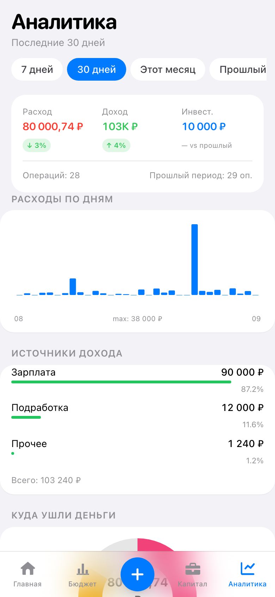

# Финансы — фулстек-демо

[](https://github.com/max1199880-bot/finance-fullstack-demo/actions/workflows/ci.yml)
[](https://github.com/max1199880-bot/finance-fullstack-demo/actions/workflows/security.yml)
[](https://github.com/max1199880-bot/finance-fullstack-demo/actions/workflows/monitor.yml)

Личный учёт денег: операции, бюджет, капитал, аналитика. Telegram Mini App и PWA.
Это демо-версия действующего приложения: интерфейс продакшена **без изменений дизайна**,
под ним — настоящий бэкенд (PostgreSQL + своё API + вход по паролю) на вымышленных данных.

**Демо: https://finance-fullstack-demo.vercel.app** — «Посмотреть демо» открывает готовый аккаунт,
можно зарегистрироваться по почте или войти через Google.

| Документ | Что в нём |
|---|---|
| [integration_documentation.md](integration_documentation.md) | **ДЗ 6:** CI/CD, вход через Google, Google Analytics 4, мониторинг, логирование, оптимизация, работа с AI |
| [security_audit.md](security_audit.md) | **ДЗ 6:** аудит безопасности — 29 находок, исправления, принятые риски |
| [backend_documentation.md](backend_documentation.md) | **ДЗ 5:** архитектура бэкенда, модель данных, все эндпоинты API |

Состояние на момент сдачи ДЗ 5 — тег [`dz5`](../../tree/dz5). Фронтенд этого приложения — ДЗ 4,
репозиторий `finance-miniapp-demo`.

| Вход | Главная | Бюджет | Капитал | Аналитика |
|---|---|---|---|---|
|  |  |  |  |  |

## Что внутри

| Слой | Технологии |
|---|---|
| Фронтенд | React 18 · TypeScript 5 (strict) · Vite 5 · Tailwind 3 · TanStack Query 5 · PWA |
| API | Supabase Edge Function на Deno — 58 маршрутов, свой роутер |
| База | PostgreSQL 17 · 11 таблиц · RLS на всех · SQL-функции для проводок |
| Вход | Supabase Auth: почта и пароль, токены обновляются сами |
| Тесты | Vitest: 63 интеграционных против живого бэкенда (из них 16 — регрессии по аудиту) + 55 на экраны |
| CI/CD | GitHub Actions: линтер, типы, тесты, Supabase в контейнере, деплой из main, мониторинг каждые 15 минут |
| Интеграции | Вход через Google (OAuth2 + PKCE) · Google Analytics 4 без персональных данных |

## Запуск

Нужны Node.js 18+ и Docker (его использует локальный Supabase).

```bash
npm install
npx supabase start
cp .env.example .env.local
npm run seed:demo
npx supabase functions serve --env-file supabase/functions/.env
npm run dev
```

В `.env.local` подставьте ключи из вывода `npx supabase start`.
Приложение откроется на http://localhost:5173.

| Команда | Что делает |
|---|---|
| `npm run dev` | Дев-сервер фронтенда |
| `npm run build` | Проверка типов и сборка в `dist/` |
| `npm test` | 55 тестов: экраны и демо-сервер (Vitest + Testing Library) |
| `npm run test:api` | 63 интеграционных теста API против локального Supabase |
| `npm run lint` · `npm run format:check` | ESLint и Prettier — те же проверки, что в CI |
| `node scripts/analyze-logs.mjs --local` | Разбор логов API через AI (см. документацию) |
| `npm run seed:demo` | Пересоздать демо-аккаунт с вымышленными данными |
| `npm run typecheck` | Проверка типов фронтенда |

Проверка типов бэкенда: `cd supabase/functions/api && deno check index.ts`.

## Как устроено

```
src/
  pages/, components/, lib/   фронтенд приложения
  lib/api.ts                  единственная точка обращения к бэкенду
  lib/supabase.ts, auth.ts    вход, выход, хранение токена
  demo/                       демо-сервер в памяти — остался как двойник для тестов экранов
  test/api/                   интеграционные тесты против настоящего бэкенда
supabase/
  migrations/                 схема, RLS-политики, SQL-функции
  functions/api/              бэкенд: index.ts (вход), lib/ (общее), routes/ (6 доменов)
scripts/seed-demo.mjs         наполнение демо-аккаунта
```

Данные идут одним путём: экран → `src/lib/api.ts` → Edge Function → PostgreSQL.
Бизнес-правила живут на сервере, фронтенд их не дублирует.

## Безопасность

- Вход через Supabase Auth: пароли не проходят через наш код и не хранятся в приложении.
- RLS включён на всех таблицах. API ходит в базу **токеном пользователя**, а не служебным ключом,
  поэтому ошибка в коде не открывает чужие данные.
- CORS ограничен адресами приложения, список задаётся переменной окружения.
- Секретов в репозитории нет: только `.env.example`.

## Данные

Все данные вымышленные. Демо-аккаунт общий: его видят все, кто нажал «Посмотреть демо», —
для своих расходов нужна отдельная регистрация. Реальных данных автора в репозитории нет.
