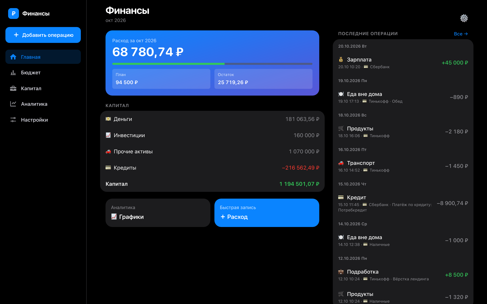
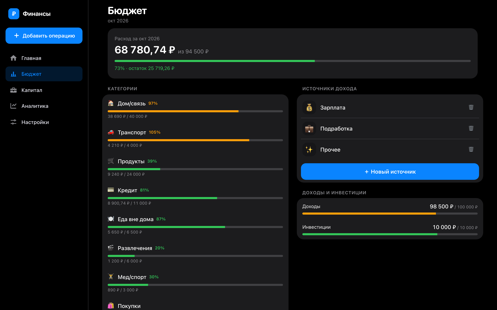
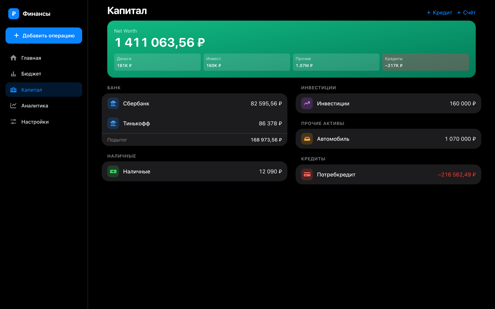
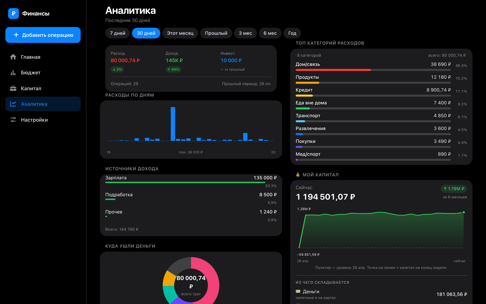
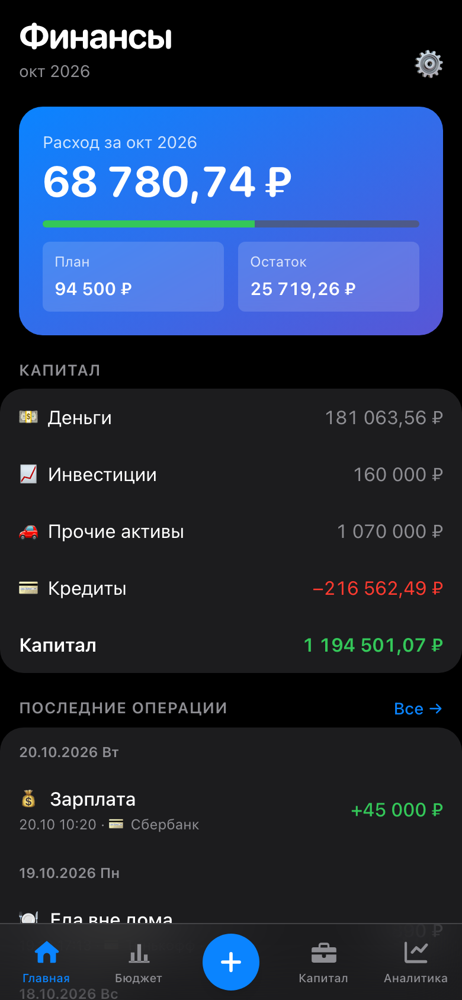
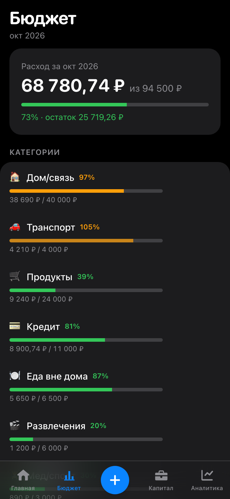
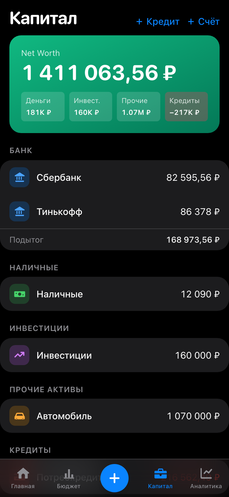
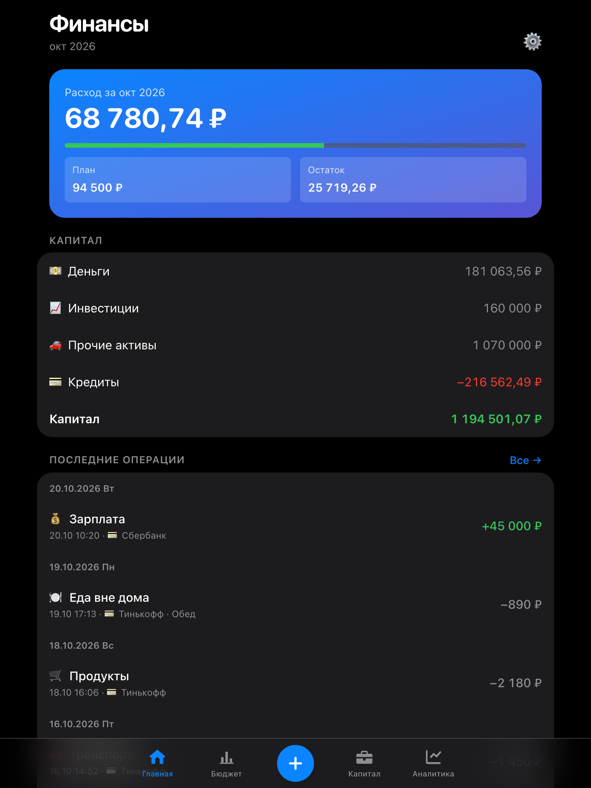

# Финансы — учёт денег и капитала

[](https://github.com/max1199880-bot/finance-fullstack-demo/actions/workflows/ci.yml)
[](https://github.com/max1199880-bot/finance-fullstack-demo/actions/workflows/security.yml)
[](https://github.com/max1199880-bot/finance-fullstack-demo/actions/workflows/monitor.yml)

Итоговый проект курса по AI-агентам: полнофункциональное веб-приложение, сделанное с
AI-агентом на всех этапах — от проверки идеи до продакшена.

**Приложение: https://finance-fullstack-demo.vercel.app** — кнопка «Посмотреть демо» открывает
готовый аккаунт с вымышленными данными за полгода. Можно завести свой аккаунт по почте или
войти через Google.

| Документ | Что в нём |
|---|---|
| **[DEVELOPMENT_PROCESS.md](DEVELOPMENT_PROCESS.md)** | Процесс разработки: AI на каждом этапе, промпты и результаты, проблемы и решения, выводы |
| [docs/process/](docs/process/) | Анализ конкурентов, настоящие промпты из журналов сессий, десктопная концепция в Figma |
| [integration_documentation.md](integration_documentation.md) | CI/CD, вход через Google, GA4, мониторинг, логирование, оптимизация |
| [security_audit.md](security_audit.md) | Аудит безопасности: 29 находок, исправления, инцидент 20.10 |
| [backend_documentation.md](backend_documentation.md) | Архитектура бэкенда, модель данных, эндпоинты API |
| [CLAUDE.md](CLAUDE.md) | Правила для AI-агента в этом репозитории |

## Идея

Учёт денег бросают из-за рутины: записать трату в таблицу с телефона — минута. «Финансы»
делают запись за три касания (сумма → категория → счёт) и показывают не только траты, но и
**капитал**: деньги на счетах, инвестиции, имущество и кредиты.

Для кого: человек, у которого деньги в нескольких банках и наличными, есть кредит или
автомобиль, и банковская аналитика видит только часть картины. Приложение работает в браузере,
как PWA на телефоне и как Telegram Mini App.

Чем отличается от конкурентов (CoinKeeper, Дзен-мани, Monefy и др. — разбор в
[docs/process/01-idea-and-competitors.md](docs/process/01-idea-and-competitors.md)):
кредиты с разбивкой платежа на тело и проценты, капитал с кредитами и без, бесплатный вход
без установки.

## Что умеет

| Экран | Функции |
|---|---|
| **Вход** | Почта и пароль, Google, демо-аккаунт в одну кнопку |
| **Главная** | Расход месяца против плана, капитал по классам активов, последние операции; история с **поиском** по комментарию и категории, **фильтрами** по периоду, типу и категории, подгрузкой страниц |
| **Добавить** | Расход, доход, перевод, покупка актива, убыток; цифровая клавиатура, выбор категории и счёта; работает офлайн — операция уйдёт на сервер при появлении сети |
| **Бюджет** | План/факт по категориям с порогами (норма, внимание, перерасход), план доходов и инвестиций |
| **Капитал** | Счета, наличные, инвестиции, имущество, кредиты; платёж по кредиту делится на тело и проценты; переоценка и продажа активов; net worth с кредитами и без |
| **Аналитика** | Расходы по дням, топ категорий, источники дохода, динамика капитала за 6 месяцев, сравнение с прошлым периодом |
| **Настройки** | Профиль, день начала месяца, категории и источники дохода, обратная связь |

Состояния загрузки и ошибок есть на каждом экране: скелетон при загрузке, понятная ошибка
с кнопкой «Повторить», отдельное состояние «Нет сети».

## Скриншоты

**Десктоп** — боковая навигация и две колонки (концепция сделана в Figma, см. процесс):

| Главная | Бюджет |
|---|---|
|  |  |
| **Капитал** | **Аналитика** |
|  |  |

**Телефон и планшет:**

| Телефон · Главная | Телефон · Бюджет | Телефон · Капитал | Планшет · Главная |
|---|---|---|---|
|  |  |  |  |

## Технологии

| Слой | Технологии |
|---|---|
| Фронтенд | React 18 · TypeScript 5 (strict) · Vite 5 · Tailwind 3 · TanStack Query 5 (офлайн-очередь) · PWA |
| API | Supabase Edge Function на Deno — 58 маршрутов, свой роутер |
| База | PostgreSQL 17 · 11 связанных таблиц · RLS на всех · SQL-функции проводок и поиска |
| Вход | Supabase Auth: почта и пароль; Google по ID-токену (OpenID Connect) |
| Интеграции | Google Identity Services · Google Analytics 4 (без сумм и персональных данных) |
| Тесты | Vitest: 79 юнит и экранов + 78 интеграционных против Supabase в контейнере |
| Инфраструктура | Docker (nginx непривилегированный) · GitHub Actions: проверки, образ, деплой, аудит, мониторинг · Vercel |
| AI | Claude Code: субагенты, MCP (Figma, браузер), `claude -p` для разбора логов |

## Запуск

### Локально

Нужны Node.js 22+ и Docker (его использует локальный Supabase).

```bash
npm install
npx supabase start
cp .env.example .env.local
npm run seed:demo
npx supabase functions serve --env-file supabase/functions/.env
npm run dev
```

В `.env.local` подставьте `API URL` и `anon key` из вывода `npx supabase start`.
Приложение откроется на http://localhost:5173, кнопка «Посмотреть демо» войдёт в локальный демо-аккаунт.

### Фронтенд в Docker

Бэкенд поднимается так же (`supabase start`, `functions serve`, `seed:demo`), фронтенд — контейнером:

```bash
docker compose --env-file .env.local up --build
```

Приложение откроется на http://localhost:8080. Образ: сборка на Node 22, раздача
непривилегированным nginx с теми же заголовками безопасности, что на проде.

### Команды

| Команда | Что делает |
|---|---|
| `npm run dev` | Дев-сервер фронтенда |
| `npm run build` | Проверка типов и сборка в `dist/` |
| `npm test` | Юнит-тесты и тесты экранов |
| `npm run test:api` | Интеграционные тесты API против локального Supabase |
| `npm run lint` · `npm run format:check` · `npm run typecheck` | Те же проверки, что в CI |
| `npm run seed:demo` | Пересоздать демо-аккаунт с вымышленными данными |
| `node scripts/analyze-logs.mjs --local` | Разбор логов API через Claude |
| `node scripts/screenshots-responsive.mjs` | Скриншоты на 390/768/1440 px и проверка горизонтальной прокрутки |

## Как устроено

```
src/
  pages/, components/        экраны и компоненты
  lib/api.ts                 единственная точка обращения к бэкенду
  lib/auth.ts, googleIdentity.ts   вход: почта, Google, демо
  demo/                      двойник API в памяти для тестов экранов
  test/api/                  интеграционные тесты против настоящего бэкенда
supabase/
  migrations/                схема, RLS-политики, SQL-функции
  functions/api/             бэкенд: index.ts (вход), lib/ (общее), routes/ (7 доменов)
docker/, Dockerfile, docker-compose.yml   контейнер фронтенда
.github/workflows/           ci.yml · security.yml · monitor.yml
```

Данные идут одним путём: экран → `src/lib/api.ts` → Edge Function → PostgreSQL. API ходит в
базу токеном пользователя, а не служебным ключом: изоляцию данных держит RLS.

**Выкладка.** Пуш в `main` → CI (линтер, типы, тесты, тесты API, образ Docker, деплой бэкенда)
→ Vercel собирает фронтенд только после зелёного CI. Подробно — в
[integration_documentation.md](integration_documentation.md).

## Данные и безопасность

- Все данные вымышленные. Демо-аккаунт общий; его нельзя испортить: удаление и смена пароля
  запрещены, ночью добавленное посетителями убирается.
- Пароли не проходят через код приложения: вход — Supabase Auth.
- Секретов в репозитории нет, только `.env.example`. Публичны лишь anon-ключ, Client ID Google,
  ID аналитики и пароль демо.
