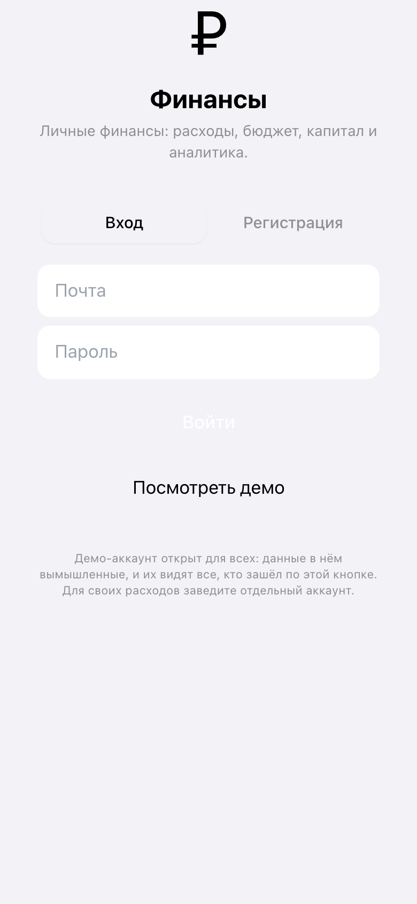
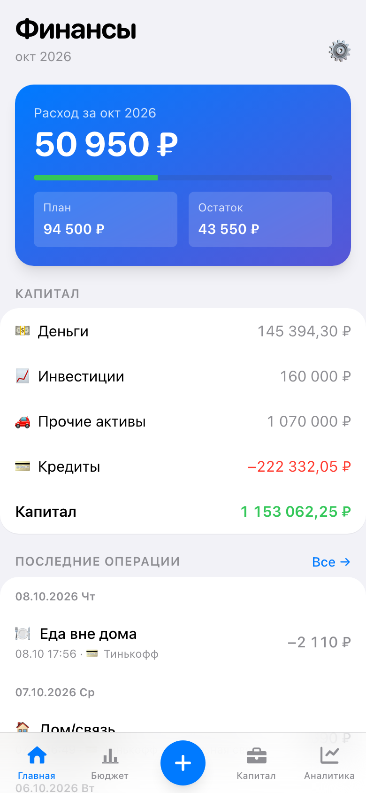
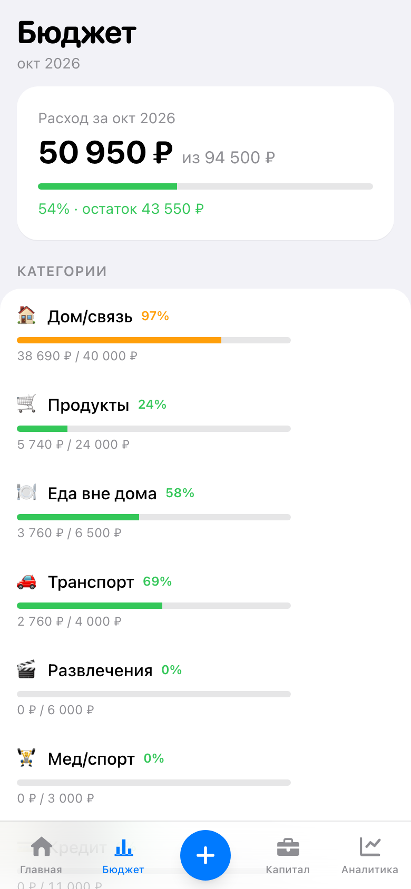
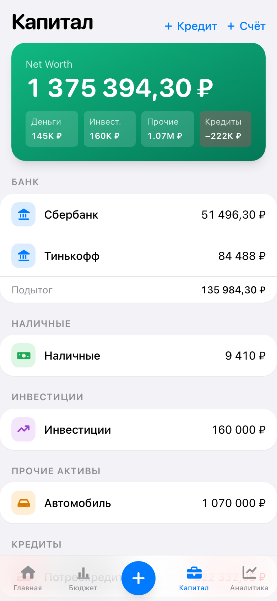

# Бэкенд «Финансы»: архитектура, развёртывание, API

Документация к ДЗ 5. Приложение — личный учёт денег: операции, бюджет, капитал, аналитика.
Фронтенд взят из ДЗ 4 без изменений дизайна; вместо демо-сервера в браузере у него теперь
настоящий бэкенд: PostgreSQL, своё API и вход по паролю.

**Демо:** https://finance-fullstack-demo.vercel.app · **API:** `https://ckckfoghvbkwivagrgoo.supabase.co/functions/v1/api` · **Вход:** кнопка «Посмотреть демо» открывает готовый аккаунт
с вымышленными данными. Для своих данных можно зарегистрироваться.

| Вход | Главная | Бюджет | Капитал |
|---|---|---|---|
|  |  |  |  |

Снимки сделаны скриптом `npm run screenshots` с боевого адреса: он заходит в демо,
обходит экраны и заодно проверяет, что в консоли нет ошибок, а API не отвечает 4xx/5xx.

---

## 1. Архитектура

```
Браузер (React 18 + Vite)
  │
  ├─ вход, токен ──────────────► Supabase Auth          (почта + пароль)
  │                                   │ выдаёт JWT
  │                                   ▼
  └─ данные ───────────────────► Edge Function «api»    (Deno, 58 маршрутов)
                                      │ ходит в базу ТОКЕНОМ ПОЛЬЗОВАТЕЛЯ
                                      ▼
                                 PostgreSQL 17
                                   ├─ 11 таблиц
                                   ├─ RLS: 12 политик  ← последний рубеж доступа
                                   └─ SQL-функции: проводка операций, остатки, кредит
```

Три слоя и их зона ответственности:

| Слой | За что отвечает |
|---|---|
| Браузер | Показ данных и ввод. Бизнес-правил не знает: любая проверка на сервере |
| Edge Function `api` | Правила приложения: валидация, формат ответов, тексты ошибок, сборка сводок |
| PostgreSQL | Хранение, целостность (ограничения), доступ (RLS) и атомарные операции (функции) |

**Главное решение: функция ходит в базу токеном пользователя, а не служебным ключом.**
Поэтому ошибка в коде API не открывает чужие данные — их отсекает RLS в самой базе.
Служебный ключ (`service_role`) используется только локальным скриптом наполнения демо-данными
и никогда не попадает в браузер.

**Второе решение: контракт путей сохранён** (`/api/transactions`, `/api/budget` и так далее).
Благодаря этому 8 экранов фронтенда переехали на настоящий бэкенд без переписывания — поменялся
только транспорт в `src/lib/api.ts`.

---

## 2. Почему Supabase, а не свой сервер

Задание допускает оба варианта. Выбран Supabase. Сравнение по тому, что важно этому проекту:

| Критерий | Supabase | PostgreSQL в Docker на своём VPS |
|---|---|---|
| Разграничение доступа | RLS — штатный механизм, политика пишется рядом со схемой | То же самое доступно, но политики надо писать и поддерживать вручную |
| Аутентификация | Готовая: регистрация, пароли, обновление токенов, сброс | Своя реализация: хеширование, токены, восстановление — отдельная работа и отдельные риски |
| Срок до рабочего демо | Часы | Сутки: сервер, Caddy, сертификаты, бэкапы, мониторинг |
| Стоимость для демо | Бесплатный тариф | Уже оплаченный VPS, но демо делило бы его с рабочими сервисами |
| Чужая нагрузка | На инфраструктуре Supabase | На своём сервере: открытую ссылку из домашней работы может открыть кто угодно |
| Привязка к поставщику | Заметная: Auth и Edge Functions | Отсутствует |

Решающими оказались два пункта: **аутентификация из коробки** (её качество важнее, чем
удовольствие написать свою) и **изоляция от рабочих сервисов** — демо из домашней работы не должно
соседствовать с личными данными на том же сервере.

Привязка к поставщику ограничена: схема, политики и функции — обычный SQL, он переносится
в любой PostgreSQL. Переписывать пришлось бы вход и слой HTTP.

---

## 3. Модель данных

11 таблиц. Основа — модель действующего приложения, перенесённая с правками под Supabase:
идентификатор пользователя теперь `auth.users.id`, имена в snake_case, деньги в `numeric(14,2)`.

```
auth.users ──1:1── profiles
                      │ (всё ниже привязано к пользователю и закрыто RLS)
                      ├── categories ──────┐
                      ├── income_sources ──┤
                      ├── accounts ────────┼── transactions
                      │     ├── account_balances   (журнал остатков)
                      │     └── asset_lots         (партии товара, FIFO)
                      ├── budget_plan_month, budget_plan_global
                      ├── net_worth_snapshots
                      └── feedback
```

Решения, которые стоит знать:

- **Деньги — `numeric(14,2)`, не `float`.** Дробные двоичные числа дают 0.1 + 0.2 = 0.30000000000000004;
  на деньгах такая ошибка копится. В JSON суммы уходят строками: `"1250.5"`.
- **Остаток счёта — журнал, а не поле.** Таблица `account_balances` только дополняется, текущий
  остаток — последняя запись. Отсюда бесплатно получается история капитала по датам.
- **Кредит — это счёт** типа `credit` с полями ставки и срока; остаток такого счёта равен долгу,
  и Net Worth его вычитает.
- **Ключ идемпотентности.** `transactions.client_tx_id` + уникальный индекс `(user_id, client_tx_id)`:
  повтор запроса (двойное нажатие, ретрай, отправка из офлайн-очереди) не создаёт вторую операцию.
- **Ограничения целостности в базе:** сумма неотрицательна, части платежа по кредиту в сумме равны
  платежу, месяц имеет вид `YYYY-MM`, день начала месяца в диапазоне 1..28, у кредита обязательны
  ставка, срок и исходная сумма.

Миграции: `supabase/migrations/` — схема, политики, функции. Применяются по порядку имён.

---

## 4. Безопасность

### Вход

Supabase Auth, почта и пароль. Пароль уходит прямо в Auth, минуя наш код: приложение паролей
не видит и не хранит. В браузере остаётся токен, он сам обновляется по refresh-токену.

Регистрация запускает триггер `handle_new_user`: создаётся профиль и стартовый набор —
8 категорий расходов, 3 источника дохода, 2 счёта. Без него новый аккаунт открывался бы пустым.

### Доступ к данным (RLS)

RLS включён на всех 11 таблицах, анонимной роли права на таблицы отозваны. Политика одинаковая
по смыслу: `user_id = auth.uid()` на чтение и на запись. `with check` в политике не менее важен,
чем `using`: без него можно было бы записать строку с чужим `user_id`.

Для `account_balances` и `asset_lots` своего `user_id` нет — право наследуется от счёта:

```sql
create policy account_balances_own on account_balances for all
  using (exists (select 1 from accounts a
                  where a.id = account_id and a.user_id = (select auth.uid())));
```

Это проверяется тестами: пользователь не видит чужие операции ни через API, ни напрямую через
PostgREST своим токеном, и не может записать операцию на чужой счёт.

### CORS

Разрешённые адреса задаются переменной `ALLOWED_ORIGINS`; функция отвечает конкретным адресом,
а не «звёздочкой» — со «звёздочкой» браузер не пропускает заголовок `Authorization`.

### Секреты

| Что | Где лежит | Попадает в браузер |
|---|---|---|
| `anon`-ключ | `.env.local`, переменные сборки | Да — и это нормально: доступ ограничивает RLS |
| `service_role`-ключ | только `.env.local` разработчика | Нет |
| Пароли пользователей | хеши в Supabase Auth | Нет |
| Пароль демо-аккаунта | переменная `VITE_DEMO_PASSWORD` | Да — данные демо вымышленные |

В репозитории лежит только `.env.example`. Файлы `.env.local` и `supabase/functions/.env`
в `.gitignore`.

---

## 5. API

Базовый адрес: `https://ckckfoghvbkwivagrgoo.supabase.co/functions/v1/api`.
Авторизация: `Authorization: Bearer <access_token>` и `apikey: <anon-ключ>`.
Ответы — JSON. Ошибка всегда одной формы: `{"error": "текст для пользователя"}`.

### Коды ответов

| Код | Когда |
|---|---|
| 200 | Успех |
| 400 | Ошибка ввода: сумма не число, нет обязательного поля, неверный тип операции |
| 401 | Нет токена, он испорчен или просрочен |
| 404 | Объект не найден — в том числе когда он чужой (так не видно, что он существует) |
| 409 | Конфликт: имя занято, актив уже продан |
| 500 | Непредвиденная ошибка; подробности в логах, наружу — общий текст |

### Маршруты (58)

**Профиль и старт**

| Метод | Путь | Назначение |
|---|---|---|
| GET | `/auth/me` | Проверка сессии |
| POST | `/auth/logout` | Подтверждение выхода |
| GET / PUT | `/me` | Профиль: валюта, день начала месяца, напоминания |
| GET | `/bootstrap?txLimit=5` | Всё для главной одним запросом |
| GET | `/month-summary?month=YYYY-MM` | Итоги месяца |
| POST | `/feedback` | Сообщение разработчику |

**Справочники** (14): `/categories` — список, `/categories/all`, `/categories/hidden`,
создание, `PUT /categories/reorder`, `PATCH /categories/:id`, `DELETE /categories/:id`,
`DELETE /categories/:id/purge`; те же шесть операций для `/income-sources`.

**Операции** (5): `GET /transactions` (фильтры `limit`, `from`, `to`, `type`, `accountId`,
`accountType`), `POST /transactions`, `PATCH /transactions/:id`, `DELETE /transactions/:id`,
`POST /loss` — списание убытка.

**Бюджет** (4): `GET /budget?month=`, `PUT /budget/category`,
`PUT /budget/category/propagate` (план на несколько месяцев вперёд), `PUT /budget/global`.

**Счета и капитал** (10): `GET /capital`, `PUT /capital/balance`, `GET /accounts`,
`GET /accounts/hidden`, `POST /accounts`, `GET /accounts/:id/tx-count`,
`GET /accounts/:id/history`, `PATCH /accounts/:id`, `DELETE /accounts/:id`,
`DELETE /accounts/:id/purge`.

**Активы и кредиты** (12): `GET /credits`, `GET /credits/:id/recalc`, `POST /credits`,
`POST /credits/:id/pay`, `POST /assets/purchase`, `POST /assets/:id/restock`,
`POST /assets/:id/sell-units`, `POST /assets/:id/sell`, `POST /assets/:id/prepayment`,
`POST /assets/:id/revalue`, `GET /assets/:id/investments`, `PATCH /assets/:id/classification`.

**Аналитика** (6): `/analytics/summary`, `/analytics/by-category`, `/analytics/by-income-source`,
`/analytics/daily`, `/analytics/networth-history`, `/analytics/sold-assets`.

Служебный: `GET /health` — отвечает без входа, по нему видно, что функция поднялась.

### Примеры запросов

Вход и получение токена:

```bash
curl -s "$SUPABASE_URL/auth/v1/token?grant_type=password" \
  -H "apikey: $ANON_KEY" -H "Content-Type: application/json" \
  -d '{"email":"demo@finance-demo.app","password":"demo-password"}'
# → {"access_token":"eyJ...","refresh_token":"...","user":{...}}
```

Главный экран одним запросом:

```bash
curl -s "$API/bootstrap?txLimit=5" -H "apikey: $ANON_KEY" -H "Authorization: Bearer $TOKEN"
```

```json
{
  "me": { "id": "d13f…", "currency": "RUB", "monthStartDay": 1, "currentMonth": "2026-10" },
  "summary": { "month": "2026-10", "totalIncome": "45000", "totalExpenses": "48840",
               "expensePF": { "planned": "94500", "actual": "48840", "percent": 52, "status": "ok" } },
  "capitalTotals": { "totalCash": "147504.3", "totalCredits": "222332.05",
                     "totalNetWorth": "1155172.25" },
  "recentTransactions": [ { "id": "…", "date": "2026-10-07T13:49:00.000Z", "amount": "690",
                            "type": "expense", "categoryName": "Дом/связь",
                            "fromAccountName": "Тинькофф", "comment": "Мобильная связь" } ]
}
```

Запись расхода (с ключом идемпотентности — повтор не создаст дубль):

```bash
curl -s -X POST "$API/transactions" \
  -H "apikey: $ANON_KEY" -H "Authorization: Bearer $TOKEN" -H "Content-Type: application/json" \
  -d '{"type":"expense","categoryId":"8542…","fromAccountId":"a1b2…",
       "amount":"1250,50","comment":"Продукты","clientTxId":"3f0c…"}'
# → {"ok":true,"id":"9d41…"}
```

Платёж по кредиту — сервер сам делит сумму на проценты и тело долга:

```bash
curl -s -X POST "$API/credits/$CREDIT_ID/pay" \
  -H "apikey: $ANON_KEY" -H "Authorization: Bearer $TOKEN" -H "Content-Type: application/json" \
  -d '{"fromAccountId":"a1b2…","categoryId":"c3d4…","amount":"8900.74"}'
# → {"ok":true,"transactionId":"…","interest":"3520.83","principal":"5379.91",
#    "overpayment":"0","newPrincipal":"244620.09"}
```

Пример ошибки:

```bash
curl -s -X POST "$API/transactions" … -d '{"type":"expense","amount":"0",…}'
# → HTTP 400 {"error":"Invalid amount"}
```

---

## 6. Ошибки и логирование

**Обработка ошибок** собрана в одной точке — `supabase/functions/api/index.ts`:

- ожидаемые ошибки обработчики бросают как `HttpError` с кодом и текстом для пользователя;
- непредвиденная ошибка превращается в 500 с общим текстом, подробности остаются в логах:
  наружу нельзя отдавать сообщения базы — они раскрывают устройство схемы;
- тела запросов не логируются: там суммы и комментарии пользователя.

На каждый запрос пишется строка JSON: уровень, метод, путь, код, длительность, идентификатор
пользователя. В облаке это видно в Logs → Edge Functions, локально — в выводе `functions serve`.

```json
{"level":"info","method":"GET","path":"/bootstrap","status":200,"ms":84,"user":"d13f…"}
{"level":"warn","method":"POST","path":"/transactions","status":400,"ms":12,"error":"Invalid amount"}
```

**На стороне приложения:** ответ 401 гасит сессию, и пользователь возвращается на экран входа —
иначе он остался бы в приложении, где каждый экран молча ошибается. Сетевой сбой трактуется иначе:
сессия лежит в браузере, поэтому приложение открывается и офлайн, показывает сохранённые данные,
а записи ждут сети в очереди.

---

## 7. Развёртывание

### Локально

Нужны Node 18+ и Docker.

```bash
npm install
npx supabase start                      # поднимает PostgreSQL, Auth, шлюз; применяет миграции
cp .env.example .env.local              # вписать ключи из вывода supabase start
npm run seed:demo                       # демо-аккаунт с вымышленными данными
npx supabase functions serve --env-file supabase/functions/.env
npm run dev                             # http://localhost:5173
```

`supabase/functions/.env` содержит одну строку:
`ALLOWED_ORIGINS=http://localhost:5173,http://127.0.0.1:5173`.

### В облаке

```bash
npx supabase login                                   # разовая авторизация CLI
npx supabase link --project-ref <ref>                # привязка к проекту
npx supabase db push                                 # миграции: схема, RLS, функции
npx supabase secrets set ALLOWED_ORIGINS=https://<домен приложения>
npx supabase functions deploy api
SUPABASE_URL=https://<ref>.supabase.co SUPABASE_SERVICE_ROLE_KEY=… npm run seed:demo
```

Фронтенд собирается статикой (`npm run build`) и выкладывается на любой хостинг статики;
в переменных сборки задаются `VITE_SUPABASE_URL`, `VITE_SUPABASE_ANON_KEY`, `VITE_DEMO_PASSWORD`.

Проверка после выкладки:

```bash
curl -s https://ckckfoghvbkwivagrgoo.supabase.co/functions/v1/api/health   # → {"ok":true,…}
```

---

## 8. Тесты

| Прогон | Что проверяет | Количество |
|---|---|---|
| `npm run test:api` | Настоящий бэкенд: вход, изоляция данных, CORS, CRUD, бюджет, капитал, активы, кредиты | 39 |
| `npm test` | Экраны приложения и логика поверх демо-сервера в памяти | 55 |

Тесты API работают против локального Supabase, без моков: смысл именно в том, что сходятся
политики RLS, SQL-функции и обработчики. Мок проверял бы только наши ожидания от самих себя.

Проверки безопасности, которые стоит отметить: запрос без токена и с подделанным токеном
получает 401; операции одного пользователя не видны другому ни через API, ни через прямой
доступ к таблицам его собственным токеном; запись на чужой счёт отклоняется.

---

## 9. Как шла разработка с AI

Роль человека — заказчик: выбрал проект, инфраструктуру и принимал результат. Роль AI-агента
(Claude Code, модель Opus 5) — разработчик: схема, миграции, API, интеграция, тесты, документация.

### Проектирование схемы

Схема не придумывалась с нуля: исходником была модель действующего приложения (Prisma, 12 сущностей).
Агент перенёс её в SQL с правками под Supabase и объяснил каждую. Промпт по смыслу:

> Перенеси модель данных приложения в SQL для Supabase. Идентификатор пользователя — `auth.users.id`.
> Деньги — `numeric(14,2)`. Добавь ограничения целостности, которые сейчас держатся только на коде:
> неотрицательные суммы, формат месяца, обязательные поля кредита. Объясни в комментариях, почему
> остаток счёта хранится журналом.

### Параллельная работа агентов

API из 58 маршрутов писали **шесть субагентов одновременно**, по домену на каждого: справочники,
операции, бюджет, счета, активы и кредиты, аналитика. Чтобы результат не разъехался, сначала
был написан общий фундамент — `lib/` с правилами денег, периодов, ошибок и доступа к базе —
и один домен-эталон. Каждому агенту задавались: его единственный файл, эталон стиля, источник
истины по поведению и требование проверить типы.

Что это дало и чего стоило:

- шесть доменов были готовы за время одного, и каждый проверил свои типы сам;
- агенты нашли **ошибки в общем фундаменте**, написанном до них: `clampedInt(null, 20, 1, 50)`
  возвращал 1 вместо 20, потому что `Number(null) === 0` — из-за этого главная просила бы
  одну операцию вместо пяти; и приведение типов, ломавшее проверку во всех доменах сразу.
  Обе починены в одном месте;
- каждый агент отдельно отчитался о местах, где эталон противоречит сам себе (например, платёж
  по кредиту отвечает кодом 400 там, где остальные эндпоинты отвечают 404). Поведение сохранено
  как в действующем приложении, расхождения записаны.

### Отладка по логам и наблюдению

Три ошибки, найденные не чтением кода, а наблюдением за работающей системой:

1. **Все запросы отвечали «нет обработчика».** В логах функции путь приходил как `/api/health`,
   хотя снаружи вызывался `/functions/v1/api/health`: шлюз передаёт внутрь имя функции, а не
   полный путь. Разбор пути исправлен, проверка живости заработала.
2. **Планы бюджета выглядели пустыми.** В базе строки были, API возвращал «план не задан».
   Запрос к таблице показал `planned_amount = NaN`: скрипт наполнения читал несуществующее поле,
   а PostgreSQL принимает `NaN` в `numeric` молча. Добавлена проверка, которая роняет наполнение
   на первой же не-сумме, — молчаливые данные хуже упавшего скрипта.
3. **Вход в демо срабатывал и тут же отменялся.** В консоли браузера был поток 401 и повторных
   выходов: запросы со старым токеном приходили уже после успешного входа и гасили новую сессию.
   Теперь сессия гасится, только если сервер отказал именно текущему токену.

### Что осталось осознанным компромиссом

- **Платёж по кредиту пишется тремя запросами, а не одной транзакцией базы.** Причина:
  требование записать его типом «расход» (иначе он исчезнет из расходов месяца и из плана/факта)
  несовместимо с готовой функцией проводки, которая уменьшает долг только для типа «платёж по
  кредиту». Обрыв связи посередине способен рассинхронизировать остаток. Исправление — отдельная
  SQL-функция `pay_credit`, вынесено в задел.
- **Правка и удаление операции тоже не атомарны** по той же причине; порядок шагов выбран так,
  чтобы сбой на первом шаге не оставлял мусора.
- **Докупка и продажа по партиям (FIFO)** в демо из ДЗ 4 были заглушками — здесь они реализованы
  по-настоящему, поэтому их поведение не с чем сверять, кроме здравого смысла и схемы.
