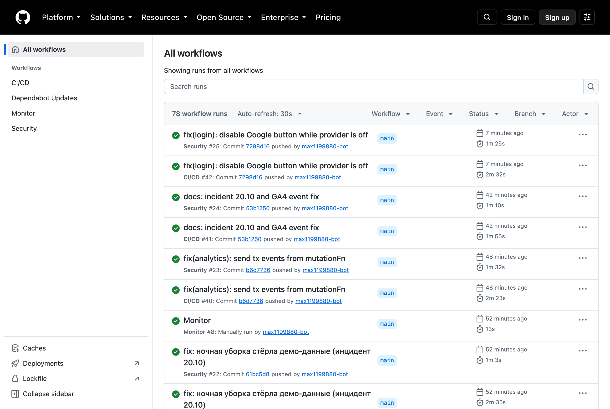
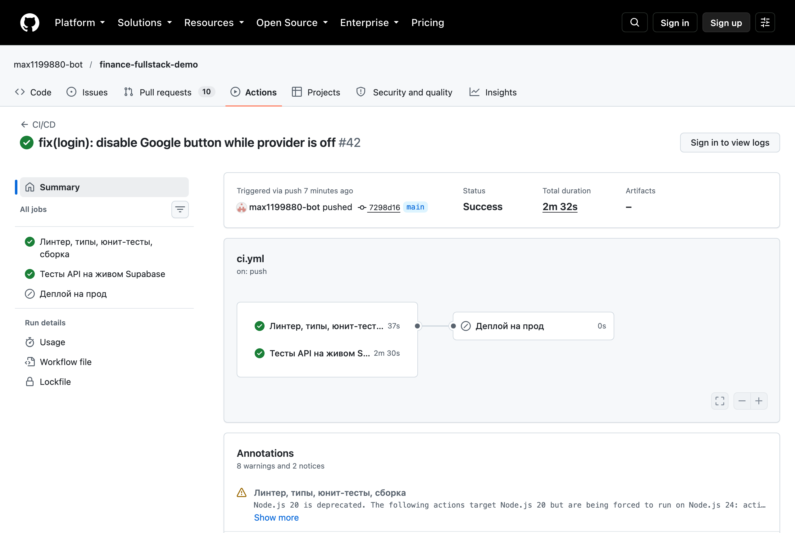
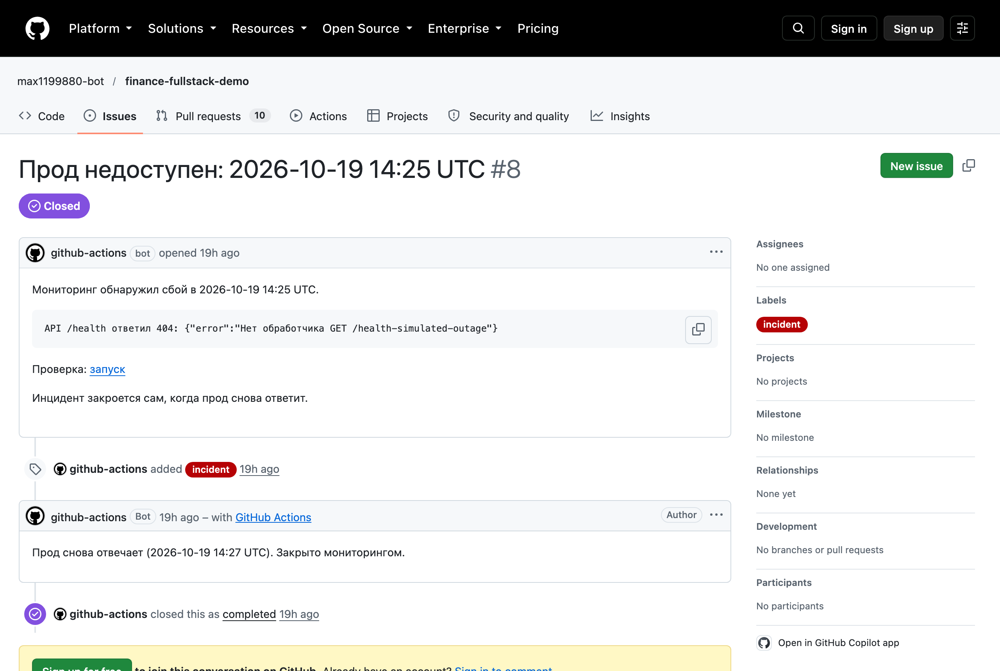
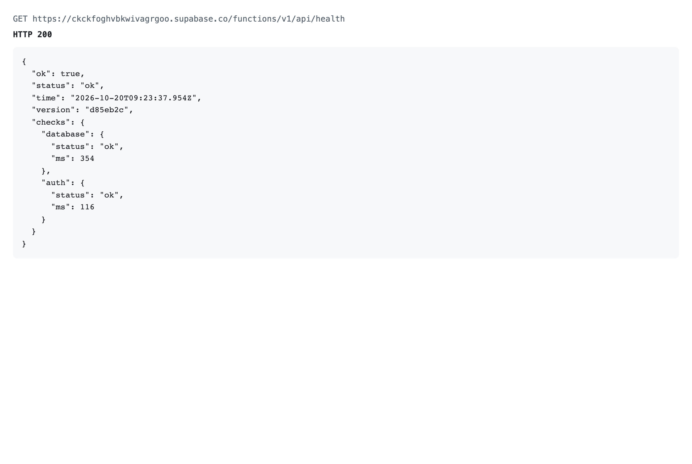
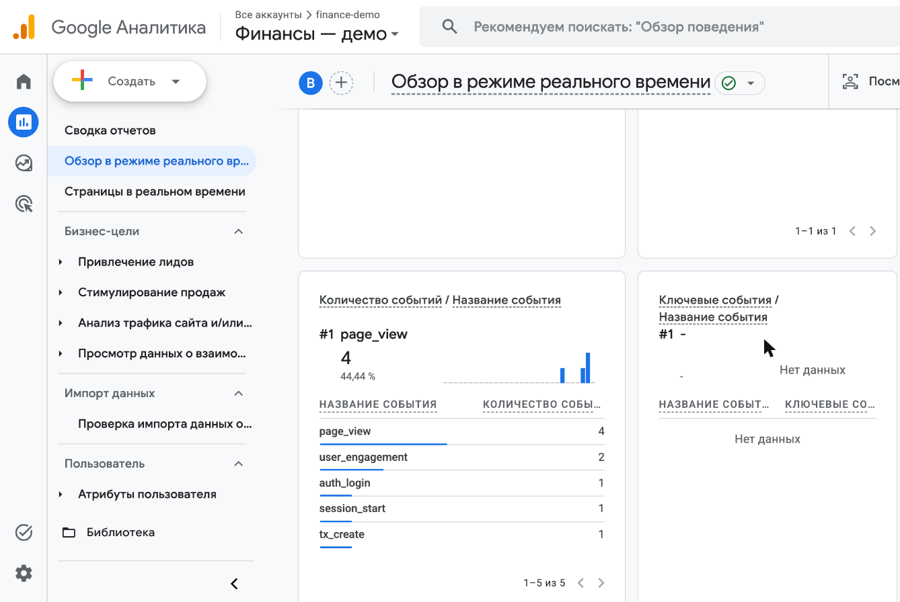

# CI/CD и интеграции сервисов

Документация к ДЗ 6. Проект тот же, что в ДЗ 5: фронтенд «Финансы» (React, Vercel) и бэкенд на
Supabase (PostgreSQL + Edge Function `api`). Состояние на момент сдачи ДЗ 5 сохранено тегом `dz5`.

**Приложение:** https://finance-fullstack-demo.vercel.app ·
**Health:** https://ckckfoghvbkwivagrgoo.supabase.co/functions/v1/api/health ·
**Пайплайны:** вкладка Actions репозитория · **Аудит безопасности:** [security_audit.md](security_audit.md)

| Что | Чем | Где в коде |
|---|---|---|
| CI/CD | GitHub Actions → Supabase + Vercel | `.github/workflows/ci.yml` |
| Безопасность в CI | npm audit, gitleaks, CodeQL, Dependabot | `.github/workflows/security.yml`, `.github/dependabot.yml` |
| OAuth2 | Google через Supabase Auth, PKCE | `src/lib/auth.ts`, `src/pages/Login.tsx`, миграция `…_oauth_profile.sql` |
| Аналитика | Google Analytics 4, события без персональных данных | `src/lib/analytics.ts` |
| Мониторинг | `/health` + проверка по расписанию + алерт issue | `lib/health.ts`, `.github/workflows/monitor.yml` |
| Логирование | JSON-логи с request_id, ошибки браузера, разбор через AI | `lib/log.ts`, `src/lib/errorReporting.ts`, `scripts/analyze-logs.mjs` |

---

## 1. CI/CD

### Схема

```
push в любую ветку / pull request
        │
        ├── quality ─────────────────────────────┐
        │     ESLint → Prettier → tsc → deno check/lint → 55 тестов → сборка
        │                                         │
        └── api-tests ───────────────────────────┤
              Supabase в контейнере раннера:      │
              миграции → функция → демо-данные →  │
              интеграционные тесты API            │
                                                  ▼
                               deploy (только push в main, оба этапа зелёные)
                                 1. миграции базы       supabase db push
                                 2. функция API         supabase functions deploy
                                 3. фронтенд            vercel build + deploy --prebuilt
                                 4. проверка прода      /health = ok и сайт отвечает 200
```

### Решения и почему так

- **Деплой только через пайплайн.** Встроенный автодеплой Vercel из git выключен
  (`vercel.json` → `git.deploymentEnabled: false`). Раньше Vercel выкладывал фронтенд сам при
  каждом пуше, не дожидаясь тестов, — это нашёл аудит (F-8). Теперь красный тест останавливает
  выкладку.
- **Тесты API идут против настоящего Supabase**, поднятого в контейнере раннера, а не против
  моков: проверяется связка RLS-политик, SQL-функций и обработчиков. Поднимаются только нужные
  сервисы — база, Auth, шлюз, рантайм функций, — прогон укладывается в несколько минут.
- **Порядок выкладки: база → функция → фронтенд.** Миграции только добавляющие: старая версия
  функции переживает новые столбцы, а новая версия не стартует без них.
- **Проверка после выкладки.** Деплой считается успешным, только если `/health` ответил `ok`
  и сайт отдал 200. Иначе джоба красная, и это видно сразу.
- **Версия на проде.** Деплой записывает короткий SHA коммита в переменную функции
  `APP_VERSION`, и `/health` её показывает.

### Защита пайплайна

Пайплайн держит токены прода, поэтому он сам — цель атаки. Что сделано (находки F-9, F-10):

| Мера | Зачем |
|---|---|
| Все сторонние actions закреплены по SHA, CLI — точными версиями | Перевешенный тег или свежий скомпрометированный релиз не получат токены |
| Секреты выдаются только шагу, которому нужны | Шагу Vercel не нужен доступ к базе, и наоборот |
| Секреты лежат в окружении `production`, а оно разрешено только ветке `main` | Код из другой ветки или PR их не получит |
| `permissions: contents: read` по умолчанию | Токен GitHub в джобах не может ничего записать |
| Данные событий не подставляются в `run:` через `${{ }}` | Нет инъекции команд через имя ветки или заголовок PR |
| Dependabot обновляет и зависимости, и закреплённые actions | Закрепления не устаревают, обновления проходят тот же CI |

### Секреты и переменные

| Имя | Тип | Откуда |
|---|---|---|
| `SUPABASE_ACCESS_TOKEN` | секрет окружения | Supabase → Account → Access Tokens |
| `VERCEL_TOKEN` | секрет окружения | Vercel → Account → Tokens |
| `SUPABASE_PROJECT_REF`, `VERCEL_ORG_ID`, `VERCEL_PROJECT_ID` | переменные репозитория | идентификаторы, не секреты |
| `DEPLOY_ENABLED` | переменная репозитория | `true` включает джобу деплоя. Пока секретов нет, джоба пропускается, а не падает на пустых токенах |

### Проверки качества кода

| Инструмент | Что проверяет | Команда |
|---|---|---|
| ESLint 9 + typescript-eslint + react-hooks | Ошибки и опасные конструкции во фронтенде | `npm run lint` |
| Prettier | Единое форматирование всего TypeScript | `npm run format:check` |
| TypeScript strict | Типы фронтенда | `npm run typecheck` |
| `deno check` + `deno lint` | Типы и правила кода функции API | в `supabase/functions/api` |
| CodeQL (security-extended) | Статический анализ уязвимостей | `security.yml` |

---

## 2. Вход через Google (OAuth2)

### Поток

```
Браузер          Supabase Auth                     Google
   │ «Войти через Google»
   │ signInWithOAuth(provider: google, PKCE) ──►
   │                   │ редирект с state и code_challenge ──► экран выбора аккаунта
   │                   │ ◄── код авторизации ─────────────────┘
   │                   │ обмен кода на токены Google (Client Secret хранится только здесь)
   │                   │ создание/поиск пользователя → триггер handle_new_user → профиль
   │ ◄── редирект на /login?code=… (одноразовый код приложения)
   │ supabase-js меняет код на сессию (code_verifier из этого браузера)
   │ → onAuthStateChange(SIGNED_IN) → главная
```

### Что сделано и почему

- **Authorization Code + PKCE**, а не implicit flow. В implicit токены приходят в адресе страницы
  (`#access_token=…`) и оседают в истории браузера и аналитике. В PKCE в адресе одноразовый код,
  бесполезный без `code_verifier`, который хранится только в этом браузере.
- **Client Secret только в Supabase.** Он не попадает ни в код, ни в браузер, ни в репозиторий.
- **`prompt=select_account`** — Google каждый раз показывает выбор аккаунта: на общем устройстве
  иначе молча подставлялся бы аккаунт предыдущего человека.
- **Профиль из данных Google.** Триггер регистрации берёт имя из `full_name`/`name` и аватар из
  `avatar_url`/`picture`. Аватар принимается только по `https://` и разумной длины: потом он
  попадёт в ``, и `javascript:` или мегабайтная строка там не нужны.
- **Адреса возврата** разрешены только для прода (`https://finance-fullstack-demo.vercel.app/**`).
  Локальные адреса в облачном проекте позволили бы направить ссылку восстановления пароля на
  чужой компьютер — это тоже находка аудита.

### Обработка ошибок

| Ситуация | Что видит пользователь |
|---|---|
| Нажал «Отмена» на экране Google | «Вход через Google отменён» |
| Провайдер выключен в проекте | Кнопка неактивна, под ней «Вход через Google пока не включён на сервере». Экран входа читает публичные настройки `/auth/v1/settings` |
| Провайдер выключили, пока человек был на Google | «Вход через Google сейчас недоступен» |
| Иная ошибка провайдера | «Не удалось войти через Google: <описание>» |
| Не удалось начать редирект | Текст ошибки, кнопка снова активна |

Служебные параметры (`?error=`, `?code=`) после обработки убираются из адреса.

Проверка выключенного провайдера появилась после проверки на проде. Без неё кнопка уводила на
страницу Supabase с ответом 400 в виде JSON, и вернуться в приложение было нельзя. Теперь кнопка
включается сама, как только провайдер включён в Supabase: новая выкладка не нужна.

### Настройка (повторить на своём проекте)

1. Google Cloud Console → OAuth consent screen: External, опубликовать (иначе войдут только тестовые пользователи).
2. Clients → Web application. Origin: адрес приложения. Redirect URI: `https://<ref>.supabase.co/auth/v1/callback`.
3. Supabase → Authentication → Providers → Google: вставить Client ID и Client Secret.
4. Supabase → URL Configuration: адрес приложения с `/**` в списке разрешённых.

---

## 3. Google Analytics 4

### Почему GA4, а не Яндекс.Метрика

Сначала была выбрана Метрика, и код под неё был готов. Но её интерфейс (создание счётчика,
настройка целей) грузится с `yastatic.net`, а через VPN разработчика этот домен недоступен —
форма создания счётчика не работала. Выключать VPN агенту нельзя (это системная настройка),
поэтому по решению владельца аналитика переведена на GA4: сервис доступен, а ресурс, поток и
события агент настроил сам. Набор событий и ограничения приватности остались прежними.

Ресурс: «Финансы — демо», веб-поток «Финансы — прод», идентификатор измерения `G-VZ5R4P4B4X`.

### Принцип: считать действия, а не деньги

Это приложение личных финансов, поэтому сбор данных ограничен намеренно:

| Отключено / вырезано | Почему |
|---|---|
| «Улучшенная статистика» потока | Сама шлёт просмотры с полным адресом — включая одноразовый `?code=` после входа через Google — и взаимодействия с формами |
| Google Signals, рекламная персонализация, рекламное хранилище | Данные учёта денег не должны попадать в рекламные профили; согласие `ad_*` — «denied» |
| Передача данных в Google для моделирования и рекомендаций | Выключена в настройках аккаунта при создании |
| Query и hash в адресе страницы | Там бывают данные формы и коды возврата после входа |
| Суммы, категории, комментарии, id в параметрах событий | Тип параметров закрыт списком меток: строка произвольного вида — ошибка компиляции |
| Сбор при включённом Do Not Track | Уважаем явный отказ пользователя |
| Сбор в разработке и тестах | Тег грузится только в собранном приложении и только при заданном идентификаторе |

### События

Приложение одностраничное, поэтому просмотр экрана (`page_view`) отправляется вручную при
каждой смене маршрута, с очищенным адресом. События — на ключевые действия, все из двух мест:
экран входа и общий модуль записи операций (`mutationDefaults.ts`), через который проходит
любая запись.

| Событие | Когда | Параметры |
|---|---|---|
| `auth_login` | Успешный вход | `method`: password / google / demo |
| `auth_signup` | Регистрация | `method` |
| `auth_login_failed` | Неудачный вход | `method` |
| `tx_create` | Записана операция | `type`: expense / income / transfer_… |
| `tx_edit`, `tx_delete` | Операция изменена, удалена | — |
| `credit_payment` | Платёж по кредиту | — |
| `asset_purchase` | Покупка актива | `type`: investment / other_asset |

Набор событий отвечает на продуктовые вопросы: доходят ли до первой операции после входа,
какой способ входа популярнее, сколько входов срывается, чем пользуются помимо расходов.

**Где отправляется событие операции — важно.** Событие уходит из `mutationFn`, после ответа
сервера, а не из `onSuccess`. Экраны передают в `useMutation` свой `onSuccess`, и TanStack
Query им заменяет `onSuccess` из общих настроек. Первая версия отправляла события именно там:
вход и просмотры доходили, а ни одного `tx_create` не было. Ошибку нашла проверка на проде,
юнит-тесты её не ловили. Теперь её закрывает тест `src/lib/mutationDefaults.test.ts`: на
старом коде он падает.

### Подключение

Идентификатор задаётся переменной `VITE_GA_ID` в окружении сборки Vercel. Без неё тег
не загружается вовсе. В CSP разрешены только `www.googletagmanager.com` (скрипт) и
`*.google-analytics.com` / `*.analytics.google.com` (отправка данных).

Проверка на проде 20.10.2026: вход в демо и запись расхода. Результат:
- В браузере ушли запросы `…google-analytics.com/g/collect` с `tid=G-VZ5R4P4B4X`.
  Одиночные события видны в адресе (`en=page_view`). Пачка событий (`auth_login`,
  `tx_create`) уходит POST-запросом в теле.
- В отчёте GA «В реальном времени»: `page_view` — 10, `auth_login` — 2, `tx_create` — 1.
- В параметрах только тип: `tx_create {type: expense}`. Суммы и категории нет.

---

## 4. Мониторинг

### Health-check

`GET /functions/v1/api/health` — без входа.

```json
{
  "ok": true,
  "status": "ok",
  "time": "2026-10-19T10:12:00.000Z",
  "version": "a1b2c3d",
  "checks": {
    "database": { "status": "ok", "ms": 18 },
    "auth": { "status": "ok", "ms": 41 }
  }
}
```

| Проверка | Как | Таймаут |
|---|---|---|
| База | SQL-функция `health_check()` ролью anon: только `now()` и версия, таблицы не читаются | 3 с |
| Сервис входа | `GET /auth/v1/health` | 3 с |

Всё работает — **200**, хотя бы одна зависимость лежит — **503** со `status: degraded`.
Наружу отдаются только статус и время каждой проверки. Тексты ошибок пишутся в лог:
health открыт без входа, а его ответ попадает в публичный issue мониторинга.

### Проверка по расписанию и алерты

`.github/workflows/monitor.yml` каждые 15 минут проверяет три вещи:

| Проверка | Что ловит |
|---|---|
| `/health` | Лежит база или сервис входа |
| Главная страница | Лежит Vercel или сломана выкладка |
| Содержимое демо: вход демо-пользователем, в `/bootstrap` есть операции | Сервис работает, но данные пропали |

Третья проверка добавлена после инцидента 20.10 (см. ниже): тогда `/health` был зелёным,
а демо — пустым.

```
проверка ──► всё в порядке ──► открыт инцидент? ──► закрыть с комментарием «восстановлено»
    │
    └──► сбой (после повтора через 20 с) ──► инцидент уже открыт? ──► ничего (без спама)
                                                  │
                                                  └──► нет ──► issue с меткой incident
                                                               → письмо владельцу
```

- **Алерт — issue в репозитории.** GitHub присылает о нём письмо, история сбоев хранится
  рядом с кодом, внешних аккаунтов не нужно.
- **Повтор через 20 секунд** отсекает разовые сетевые сбои раннера.
- **Один открытый инцидент на сбой** — пока прод лежит, новые issue не создаются.
- Побочный эффект: бесплатный проект Supabase засыпает после недели без запросов, а
  регулярная проверка держит его активным.

Внешний сервис (UptimeRobot и подобные) можно добавить поверх: достаточно направить его на тот
же `/health`. Здесь обошлись GitHub Actions, чтобы не заводить ещё один аккаунт.

Проверка алерта: запуск вручную с параметром `simulate_outage` опрашивает несуществующий
адрес вместо `/health`. Так открылся issue с меткой `incident`, а следующий обычный запуск
закрыл его сам.

### Инцидент 20.10.2026: ночная уборка стёрла демо

**Что произошло.** В 00:00 UTC ночная уборка `cleanup_demo()` удалила все данные демо:
160 операций, счета и категории. Сайт и `/health` работали, но демо было пустым.

**Причина 1.** Уборка удаляла всё, что создано после «момента наполнения». Этим моментом
считалось время создания профиля. Но профиль создаётся при регистрации, до наполнения.
Поэтому все данные наполнения выглядели «добавленными посетителями».

**Причина 2.** Первое исправление ставило отметку наполнения `seeded_at` по часам Mac,
на котором запускался скрипт. Часы базы шли на ~60 мс впереди. Строки получали
`created_at` позже отметки, и уборка снова удаляла всё. Это показал регрессионный тест.

**Исправление.**
1. Отметку `seeded_at` ставит сама база: функция `mark_demo_seeded()` берёт `clock_timestamp()`.
   Время записи данных и время отметки идут от одних часов.
2. Нет отметки — уборка ничего не удаляет и возвращает `skipped`.
3. Мониторинг проверяет содержимое демо, а не только `/health`.
4. Два регрессионных теста в `src/test/api/audit-regressions.test.ts`. Оба падают на старой
   функции.

**Восстановление.** Демо заново наполнено (`npm run seed:demo`, 162 операции). Пробный запуск
уборки в облаке удалил 0 строк.

**Вывод.** Сравнивать время можно только из одного источника. И «сервис отвечает» не
означает «данные на месте»: мониторингу нужна проверка содержимого.

---

## 5. Логирование

### Формат

Одна строка JSON на событие, в `Supabase → Logs → Edge Functions`:

```json
{"ts":"2026-10-19T10:12:00.123Z","level":"info","event":"request","request_id":"3f0c…","method":"GET","path":"/bootstrap","status":200,"ms":84,"user":"d13f…"}
{"ts":"2026-10-19T10:12:01.456Z","level":"warn","event":"request","request_id":"9a2b…","method":"POST","path":"/transactions","status":400,"ms":12,"error":"Invalid amount"}
{"ts":"2026-10-19T10:12:02.789Z","level":"error","event":"client_error","source":"browser","error":"TypeError: …","page":"/budget","release":"a1b2c3d"}
```

| Уровень | Когда |
|---|---|
| `info` | Успешный запрос |
| `warn` | Ошибка клиента (4xx): неверная сумма, нет прав, не найдено |
| `error` | Сбой сервера (5xx), деградация health, ошибка в браузере |

Ошибки клиента — `warn`, а не `error`, чтобы алерты на `error` не срабатывали от каждой опечатки в сумме.

### Правила, которые держит модуль, а не каждый обработчик

- **request_id в каждой строке и в заголовке ответа `x-request-id`.** По нему собирается история
  одного запроса; при ошибке 500 он приходит и в теле ответа, чтобы пользователь мог назвать его.
  Присланный клиентом id принимается, только если похож на id, — иначе через заголовок можно
  было бы подделать строку лога.
- **Вычищение полей.** `authorization`, `token`, `password`, `apikey`, `amount`, `comment`
  заменяются на `[скрыто]`, даже если их передали по ошибке. Тела запросов не логируются вовсе.
- **Ошибки браузера в те же логи.** `src/lib/errorReporting.ts` ловит необработанные ошибки и
  отклонённые промисы и отправляет их на `POST /client-errors`: не больше 5 за загрузку страницы,
  без повторов, с обрезанным текстом, адрес — без query. Сервер принимает не больше 4 КБ и не
  больше 20 отчётов в минуту с адреса.

### Разбор логов через AI

`scripts/analyze-logs.mjs` превращает логи в отчёт дежурного инженера.

```bash
node scripts/analyze-logs.mjs --local --since 1h            # логи локального стенда
node scripts/analyze-logs.mjs --file logs.jsonl --out report.md   # экспорт из Supabase Logs
node scripts/analyze-logs.mjs --local --dry-run             # только сводка, без модели
```

Как он устроен:

1. **Сводка считается кодом, не моделью**: уровни, коды ответов, топ повторяющихся ошибок,
   p50/p95 времени по маршрутам. Тысячи сырых строк модели не нужны — она путается в повторах.
2. **Модели отдаётся сводка и до 30 строк-примеров** — по ним она ссылается на конкретные request_id.
3. **Промпт задаёт роль и формат**: вывод, таблица проблем по влиянию, что проверить, скорость.
   Ожидаемое поведение (401 при просроченном токене, 400 при неверной сумме) отделяется от сбоев.
4. **Защита от внедрения в промпт.** Часть строк присылает браузер без входа — то есть кто угодно.
   Данные обёрнуты в маркеры с пометкой «недоверенные», а модель запускается без инструментов
   (`--tools ""`): внедрённый в лог текст не сможет заставить её прочитать файлы.

Пример отчёта на логах локального стенда — [docs/log-analysis-example.md](docs/log-analysis-example.md).

---

## 6. Оптимизация

Предложения искал AI-агент по замерам: размер сборки, профиль запросов к базе. Применялось
только то, что подтвердилось замером до и после.

### Стартовая загрузка фронтенда: 187 → 130 КБ gzip (−31 %)

| | Было | Стало |
|---|---|---|
| Файлов на старте | 1 (657 КБ, 187 КБ gzip) | 5 (≈130 КБ gzip) |
| Экраны «Капитал», «Добавить», «Аналитика», «Бюджет», настройки | в стартовом файле | грузятся при первом переходе (11, 7,5, 6, 2,3, 3 КБ gzip) |
| Клиент Supabase | весь `supabase-js` (58 КБ gzip) | только `@supabase/auth-js` (25 КБ gzip) |
| Библиотеки | вместе с кодом приложения | отдельными файлами — после деплоя браузер берёт их из кеша |

- **Ленивые экраны** (`React.lazy`). Вход и главная остаются в стартовом файле — с них
  начинается любой запуск. Офлайн не страдает: сервис-воркер заранее кладёт в кеш все части.
- **Только модуль авторизации.** Фронтенду из Supabase нужен лишь вход — данные идут через
  наш API. Клиенты базы, хранилища, realtime и функций весили треть стартовой загрузки.

### Остатки счетов: по одной строке на счёт

**Проблема.** Чтобы показать текущие остатки, API забирал из базы всю историю остатков
нужных счетов и в коде оставлял последнюю строку. Объём ответа рос с каждой операцией.

**Замер** `GET /capital`, 30 запросов после прогрева, локальный стенд:

| Вариант | 178 строк истории (демо) | 30 000 строк истории |
|---|---|---|
| Было: вся история в API | 5,7 мс | 15,1 мс |
| Попытка 1: `DISTINCT ON` в SQL | 6,9 мс | **21,0 мс — медленнее** |
| Итог: верхняя строка индекса на каждый счёт | ≈6 мс | **5,5–6,4 мс** |

Первая версия выглядела правильной, но замер показал обратное: `DISTINCT ON` просматривает
всю историю счёта, а не берёт верхнюю строку индекса. Итоговая функция `current_balances()`
делает по одному обращению к индексу `(account_id, seq desc)` на счёт — время не зависит от
длины истории. На демо-данных разницы нет, выигрыш в 2,5 раза появляется по мере роста истории.

### Что предложено, но не сделано

- **Проверка токена без сетевого запроса.** Сейчас функция на каждый запрос спрашивает
  Supabase Auth, действителен ли токен (`getUser`). Проверка подписи JWT по публичному ключу
  (`getClaims`) сэкономила бы этот запрос, но отозванный токен действовал бы до истечения.
  Для финансового приложения выбрана строгость.
- **Сводка месяца в SQL.** Суммы месяца считаются в коде по выборке операций; агрегат в базе
  был бы быстрее на большой истории. На текущих объёмах выигрыш не измерим.

---

## 7. Как использовался AI

Работа шла в Claude Code. Человек выбирал решения (основа проекта, провайдер входа,
аналитика, отказ от платежей) и делал действия в консолях сервисов, требующие его аккаунта.
Агент писал код, конфигурацию, тесты и документацию.

| Задача | Как участвовал AI | Что проверял человек или замер |
|---|---|---|
| **Конфигурация CI/CD** | Агент сгенерировал `ci.yml`, `security.yml`, `monitor.yml` по описанию этапов | Пайплайн на реальном PR. Первый же прогон упал: тесты API требовали Node 22, а в CI стоял 20 — локально (Node 25) это не воспроизводилось. Такую разницу окружений и должен ловить CI |
| **Аудит безопасности** | Два субагента-аудитора параллельно: фронтенд с пайплайнами и бэкенд, по OWASP Top 10, с воспроизведением атак на стенде | Каждая находка сверялась с кодом; на каждое исправление — регрессионный тест. Аудитор пайплайнов нашёл проблемы в только что сгенерированном CI (F-8, F-9, F-12): AI проверял AI |
| **Разбор логов** | `scripts/analyze-logs.mjs`: сводку считает код, выводы делает Claude | На реальном логе модель нашла deadlock с точным местом в коде и распознала подложенную в лог инструкцию как атаку |
| **Отладка** | Регрессионный тест упал с 500 → request_id → строка лога → «deadlock detected» → причина в порядке блокировок | Три итерации исправления, каждая проверена тем же тестом (подробно — `security_audit.md`, B-3) |
| **Проверка на проде** | Агент прошёл сценарии в браузере: вход в демо, запись расхода, сверка запросов в GA и отчёта «В реальном времени» | Нашлись две ошибки, которые не ловили тесты: события операций не отправлялись (`onSuccess` экрана заменял общий) и кнопка Google вела на JSON-ошибку. Обе исправлены, на первую — регрессионный тест |
| **Инцидент 20.10** | Агент нашёл причину по журналу `pg_cron` и написал тест, воспроизводящий наполнение демо | Первая гипотеза о разнице часов была отброшена по сравнению с точностью до секунды. Тест показал, что она верна: разница ~60 мс |
| **Оптимизация** | Агент предложил ленивые экраны, облегчённый клиент Auth, выборку остатков в SQL | Замеры до и после. Одна оптимизация оказалась ухудшением (21 мс против 15) и была переделана |

Промпт для разбора логов — в `scripts/analyze-logs.mjs`; промпт аудитору — в
`security_audit.md`. Ещё два промпта, которые пригодились при работе с логами вручную:

**Поиск по одному запросу:**

> Вот строки лога API с одним request_id: <строки>. Восстанови, что происходило с запросом
> по шагам, где он упал и почему. Если причина в базе — какая блокировка или ограничение.
> Не предполагай того, чего нет в строках.

**Регрессия после деплоя:**

> Вот сводки логов за час до и час после выкладки версии <sha>: <сводка до>, <сводка после>.
> Какие маршруты стали медленнее (p95) или чаще отвечают ошибкой? Отдели изменения, которые
> объясняются нагрузкой, от тех, что похожи на регрессию кода.

---

## 8. Скриншоты

Снимает `scripts/screenshots-dz6.mjs` (публичные страницы, без входа). Отчёт GA снят вручную.

**Пайплайны.** Каждый пуш в `main` проходит CI/CD и проверку безопасности.



**Запуск CI/CD.** Линтер, типы, юнит-тесты и сборка параллельно с тестами API на Supabase
в контейнере. Деплой пропущен: он включается переменной `DEPLOY_ENABLED`.



**Алерт мониторинга.** Имитация сбоя: issue открыт автоматически и закрыт, когда прод ответил.



**Health-check прода.** База и сервис входа проверяются при каждом запросе.



**Google Analytics 4, отчёт «В реальном времени».** Вход в демо и запись расхода на проде.



**Экран входа.** Кнопка Google ждёт включения провайдера в Supabase.


